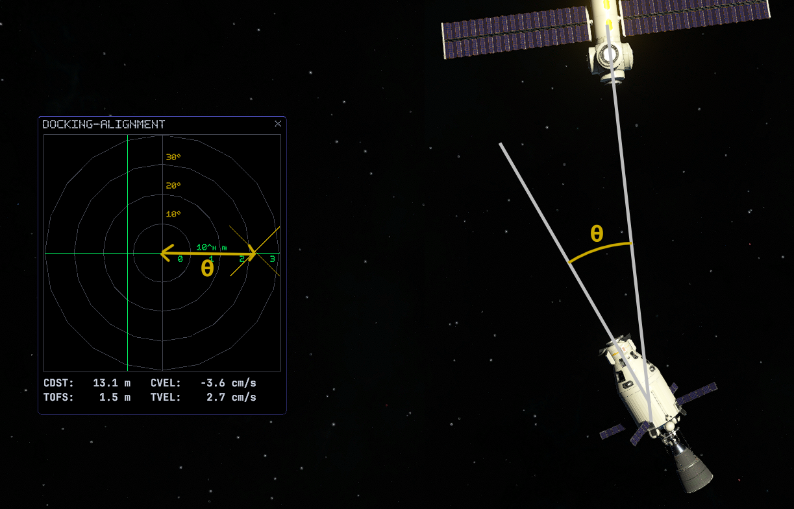
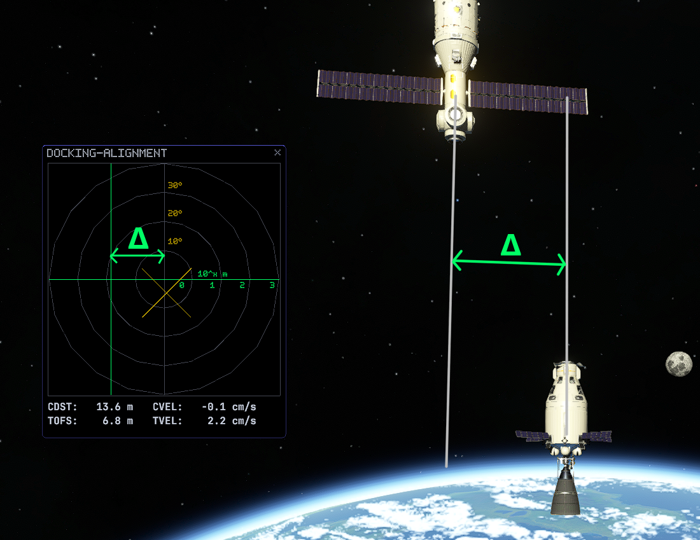
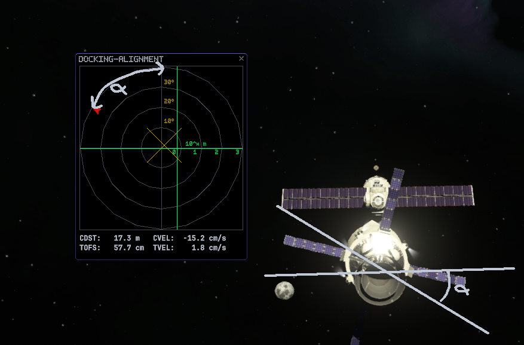
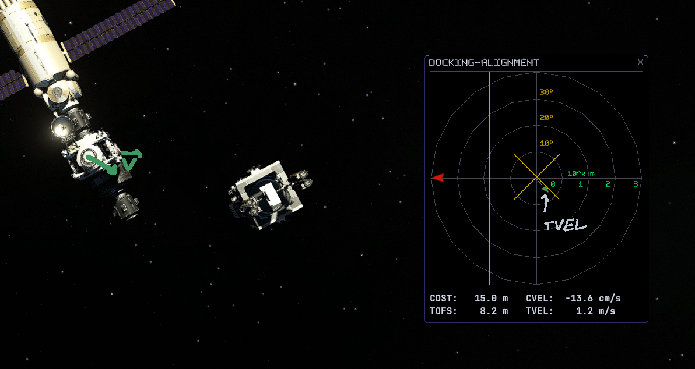

# Docking Alignement Display

Adds a new instrument providing necessary information to dock with precision to KSP2 Redux.

Inspired by the great [Docking Port Alignment Indicator](https://spacedock.info/mod/543/Docking%20Port%20Alignment%20Indicator) mod for KSP1 as well as the Docking MFD from the Orbiter Game.

## Installation

1. Download the latest release of the mod (`DockingAlignmentDisplay.zip`).
2. Extract the zip file into a `DockingAlignmentDisplay` folder in `<your KSP2 Redux install>\mods`. The folder structure should look like `<root>\mods\DockingAlignmentDisplay\swinfo.json`.

## Planned features

- [x] Basic docking informations: tangent offset, misalignment, basic metrics
- [x] Relative rotation indicator
- [x] Relative velocity indicator
- [x] Setting to toggle between linear and log scale for the offset indicator
- [ ] Simple selector for nearby docking ports to target
- [ ] "Align planes" tool

## Usage

### Misalignment

The gold crosshair indicates the angle between your craft and the target docking port. If the crosshair is to the right of the center of the display, it means that you need to rotate towards the right.

When the gold crosshair is at the center of the display, you are aligned with the axis parallel to the target docking port.

### Offset

The green crosshair indicates the tangent offset between your craft and the target docking port. If the crosshair is to the left of the center of the display, it means that you need to translate towards the left.

When the green crosshair is at the center of the display, you are in front of the target docking port.

### Roll

The small arrow indicates the relative roll between your craft and the target docking port. If the arrow is to the left you need to rotate your craft towards the left.

When the arrow is at the top of the display, you are aligned in roll with the target docking port.

### Tangent velocity

The small green arrow indicates the current tangent velocity vector between your vessel and the target docking port as indicated on the picture.

### Metrics

- **CDST (Course Distance)**: Distance from the vessel to the target docking port in the axis parallel to the target port.
- **CVEL (Course Velocity)**: Relative velocity between the vessel and the target docking port in the axis parallel to the target port.
- **TOFS (Tangent Offset)**: Distance from the vessel to the target docking port in the plane tangent to the parallel axis.
- **TVEL (Tangent Velocity)**: Relative velocity between the vessel and the target docking port in the plane tangent to the parallel axis.
